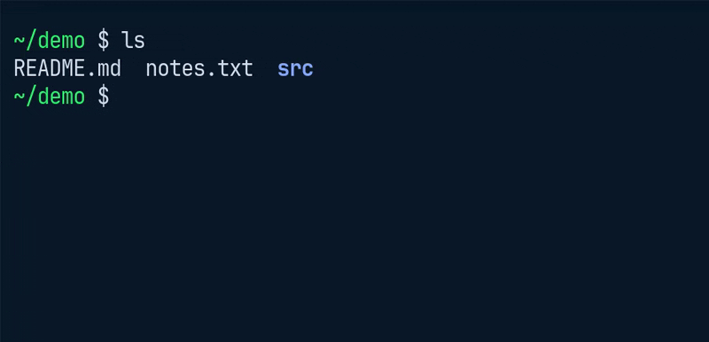

# zsh-ime-reset

You start typing a command with the Japanese input method still on, `ls` comes out as "ｌｓ", and you want to scream. This zsh plugin puts an end to that. [日本語](README.md)



It switches the IME back to alphanumeric automatically at these three moments:
- **After Enter runs a command.** The next command can be typed as it is, without switching the IME.
- **When the cursor gets back to the head of the line.** For example, when `Ctrl+U` clears the line or `Ctrl+A` moves to the head.
- **When you come back to the terminal (it gets the focus) with the cursor at the head of the line.** For example, after typing Japanese in another app and returning with Alt+Tab.

At each of them, alphanumeric is what you type next, so the IME is switched back for you. Anywhere else on the line, you may be typing Japanese (an argument, say), so it does nothing.

Turn the IME on with your usual key only when you type Japanese; after the command runs, you are back to alphanumeric.

Works on Linux (fcitx5, ibus), macOS and WSL2 (the Windows IME).

## Install

```zsh
git clone https://github.com/yoohey/zsh-ime-reset ~/.zsh/zsh-ime-reset
echo 'source ~/.zsh/zsh-ime-reset/zsh-ime-reset.plugin.zsh' >> ~/.zshrc
```

- **macOS** switches with [macism](https://github.com/laishulu/macism): `brew install laishulu/homebrew/macism`
- **WSL2** loads a different file (`zsh-ime-reset-wsl.plugin.zsh`; see [WSL2 notes](#wsl2-notes)).
- Where there is no command to switch the IME (a server, for one), it does nothing, so a `.zshrc` shared between machines is safe.

## Turning it off

Set a variable to `0` to turn off its moment. Put it in `.zshrc` before the `source` line (typed in a running shell, it works at once, too).

| Variable | Turns off |
|---|---|
| `ZSH_IME_RESET_ON_ENTER=0` | when Enter accepts the line |
| `ZSH_IME_RESET_ON_HEAD=0` | when the cursor gets to the head of the line |
| `ZSH_IME_RESET_ON_FOCUS=0` | when the terminal gets the focus |

```zsh
ZSH_IME_RESET_ON_FOCUS=0
source ~/.zsh/zsh-ime-reset/zsh-ime-reset.plugin.zsh
```

## Where it works

| Where | Command used | Needs |
|---|---|---|
| Linux with fcitx5 | `fcitx5-remote -c` | fcitx5 |
| Linux with ibus (Fedora, Ubuntu, ...) | `ibus engine xkb:jp::jpn` | ibus; for another layout set `ZSH_IME_RESET_IBUS_ENGINE=xkb:us::eng` before loading |
| macOS | `macism com.apple.keylayout.ABC` | `brew install laishulu/homebrew/macism` |
| WSL2 (the Windows IME) | a resident PowerShell closes the IME of the foreground window with the Win32 API | a separate file, `zsh-ime-reset-wsl.plugin.zsh` (uses `powershell.exe`, part of Windows); see [WSL2 notes](#wsl2-notes) |

## Or paste it into your `.zshrc` (Enter only)

It is only a few lines, so you need neither a plugin manager nor this repository. Paste the block for your OS into your `.zshrc`. It does nothing where the command is missing. The WSL2 part is longer, so it is a separate file (see "WSL2 notes" below).

```zsh
# Linux: fcitx5 if present, otherwise ibus (use xkb:us::eng for a US layout)
if (( $+commands[fcitx5-remote] )); then
  _ime_reset() { fcitx5-remote -c &> /dev/null }
elif (( $+commands[ibus] )); then
  _ime_reset() { ibus engine xkb:jp::jpn &> /dev/null }
fi
if (( $+functions[_ime_reset] )); then
  autoload -Uz add-zle-hook-widget
  add-zle-hook-widget zle-line-finish _ime_reset
fi
```

```zsh
# macOS (macism)
if (( $+commands[macism] )); then
  _ime_reset() { [[ $(macism) == com.apple.keylayout.ABC ]] || macism com.apple.keylayout.ABC &> /dev/null }
  autoload -Uz add-zle-hook-widget
  add-zle-hook-widget zle-line-finish _ime_reset
fi
```

The `if` registers the hook only when the command exists. Without it, a machine lacking fcitx5 / macism (Fedora, for one) shows its "install package?" command-not-found prompt on every Enter, which is painful. Using an IME other than fcitx5, ibus or macOS's? Replace the body of `_ime_reset` with whatever command turns your IME off. The plugin file (`zsh-ime-reset.plugin.zsh`) is nearly the same code, with comments and a variable for the ibus engine name. Adjust it to your environment.

## When it switches, in detail

The state is checked at each moment, so setting a variable in a running shell works at once (`ZSH_IME_RESET_ON_FOCUS` from the next prompt). The head and focus moments were added in 2026-10; the first public version switched on Enter only. For that behavior, set `ZSH_IME_RESET_ON_HEAD=0` and `ZSH_IME_RESET_ON_FOCUS=0`, and it switches only when Enter runs a command.

- **When the cursor gets to the head of the line**: it switches back then. Moving to the head means you are about to type a command, so alphanumeric it is. Not during the incremental history search (`Ctrl+R`), where the cursor jumps with the matches.
- **When the terminal gets the focus**: it switches back when the focus comes back and the cursor is at the head. While a command runs (watching a log with `tail -f`, for example), nothing happens. In a terminal without focus events, this moment may not work.
- If you move between windows while picking a completion from the menu with Tab (`zstyle ':completion:*' menu select`), the menu closes. The candidate you had picked stays on the line; press Tab again to go on.
- **In tmux, add `set -g focus-events on`**: it then works when a pane gets the focus (also when you select another pane or window), switching back at the head of the line as above.

## Notes (ibus / GNOME)

- **The top bar indicator can stay out of date.** After `ibus engine` switches from outside, the input is alphanumeric again, but GNOME's top bar may keep showing "あ" (seen on Fedora: the input-source menu still has the Japanese source selected, and picking a source again changes it to "en"). Typing is alphanumeric, so it works; only the display lags.
- **Match the engine name to your keyboard layout.** The default is the Japanese layout, `xkb:jp::jpn`. On a US-layout keyboard use `xkb:us::eng`, or keys such as `@` and `"` may move to their Japanese-layout positions (a caution from a Fedora setup whose input source was "English (US)"; whether the keys actually shift was not checked). Edit that line in the pasted block; with the git install, add one line before the `source` line:

  ```zsh
  ZSH_IME_RESET_IBUS_ENGINE=xkb:us::eng
  source ~/.zsh/zsh-ime-reset/zsh-ime-reset.plugin.zsh
  ```

## WSL2 notes

**WSL2 has a separate file, `zsh-ime-reset-wsl.plugin.zsh`.** Closing the Windows IME needs a resident PowerShell, which is too much to carry into other systems (Linux, macOS). It feels the same (Enter and the head of the line put you back to alphanumeric; the [same moments](#when-it-switches-in-detail)), but **on WSL2 load `zsh-ime-reset-wsl.plugin.zsh` instead of `zsh-ime-reset.plugin.zsh`** (not both). It does nothing where `powershell.exe` is not found.

```zsh
git clone https://github.com/yoohey/zsh-ime-reset ~/.zsh/zsh-ime-reset
echo 'source ~/.zsh/zsh-ime-reset/zsh-ime-reset-wsl.plugin.zsh' >> ~/.zshrc
```

A Linux program in WSL cannot touch the Windows IME directly, so it goes through PowerShell. One PowerShell (part of Windows) is kept running, and at each moment it is asked to switch the IME back to alphanumeric.

```
each zsh --"off"--> named pipe (FIFO) --> relay (zsh) --> powershell.exe
```

- **It is the window in front that goes back to alphanumeric.** When a command runs on its own in a background pane (tmux `send-keys`, an AI tool, ...), the Japanese input in another app you are using at that moment may be cut off.
- **Switching back only writes one line into the pipe** (no waiting). There is one PowerShell for the whole PC (about 80 MB), however many shells are open.
- **It ends by itself when unused.** Ten minutes after the last switch, the relay and PowerShell end; the next moment to switch starts them again. The time-out can be changed with a variable (it applies to PowerShell started from then on).

  ```zsh
  ZSH_IME_RESET_WSL_IDLE=1800   # 30 minutes
  source ~/.zsh/zsh-ime-reset/zsh-ime-reset-wsl.plugin.zsh
  ```
- **Starting takes 1.5 seconds or so.** Right after a shell opens, or the first time after the time-out, the switch comes a little late. **The first start after a reboot may take longer** (loading PowerShell and .NET, the first run of the C# compiler, and so on).
- PowerShell is started detached from the terminal (`setsid`, present on Debian, Ubuntu and others). Run in the background while still attached, it gets stopped when WSL touches the terminal, the IME stays on, and the terminal even seems to freeze.
- If PowerShell dies, running commands and other work do not freeze. Next time, the relay starts PowerShell again and sends the line again; that may take 1.5 seconds or so.
- No `.ps1` file is read, so the PowerShell execution policy does not matter. All that is sent to PowerShell is one fixed line that closes the IME; what is written into the pipe is never run as it is. The pipe is created in `$XDG_RUNTIME_DIR` (or `/tmp`), readable and writable by you only.
- Verified on WSL2 (Ubuntu 24.04, and a fresh Debian 13) on Windows 11, with Windows Terminal. It switches back with Google Japanese Input, Microsoft IME and Copilot IME alike.

## How it works

The moments are watched with hooks of zsh's line editor (zle). The watching lives in `zsh-ime-reset-hooks.zsh`, read by both `zsh-ime-reset.plugin.zsh` and the WSL2 file. The command that actually switches to alphanumeric (`fcitx5-remote -c` and so on) is a function, `_ime_reset`, defined for each environment and called from every moment. With the plugin file alone, it switches on Enter only, as before.

### On Enter

A `zle-line-finish` hook, which runs when the line is accepted, that is, when Enter is pressed in that terminal. `precmd` (just before the prompt) was not used: it also runs when a background command ends, and would switch off the IME of whatever other window has the focus then. On macOS the switch is skipped when the source is already ABC, so an ordinary Enter does no extra work.

Note: the Enter that confirms an IME conversion does not reach zsh, so it does not switch; confirm the Japanese, then the next Enter does.

### When the cursor gets to the head of the line

A `zle-line-pre-redraw` hook (it runs each time zsh redraws the line being typed) looks at the cursor position (`$CURSOR`). It switches back only at the moment it changes from "not at the head" to "at the head"; however often the line is redrawn while it stays there, it switches once.

It does not switch at the head in these cases:

- **When a new prompt appears**: Enter has switched already. And when a background command ends and the prompt is redrawn, it must not cut off the Japanese you are typing in another window.
- **During the history search (`Ctrl+R`)**: the cursor can jump to the head with the matches, which would cut off a search word typed in Japanese (told apart with `$ISEARCHMATCH_ACTIVE`).

### When the terminal gets the focus

It uses the terminal's "focus events". After `print -n '\e[?1004h'`, the terminal sends `\e[I` when it gets the focus and `\e[O` when it loses it, the same way as key presses (see the note below about `\e`).

- Focus events are turned on with `\e[?1004h` when a prompt appears (`zle-line-init`), and off with `\e[?1004l` just before Enter runs a command (`zle-line-finish`). So while a command runs (watching a log with `tail -f`, for example), moving between windows does nothing, and the command never gets focus events.
- Focus in (`\e[I`) is bound to a widget that switches back if the cursor is at the head (0).
- Focus out (`\e[O`) is bound to a widget that does nothing. Unbound, it would be read as two keys, Esc and `[O` (in vi command mode, `O` would open a new line).
- In a terminal without this feature, only the focus moment does not work.

Note: focus events are a feature of the terminal, not of zsh (tmux's `focus-events` is the same thing). Sequences such as `\e[...]` are control codes that never show on the screen; zsh and the terminal use them to talk, like "the focus is here" or "tell me when it comes". `\e[?1004h` means "tell me when the focus changes", `\e[?1004l` "no need to tell me any more", `\e[I` "the focus came", and `\e[O` "the focus left".

### When focus does not switch back in tmux

tmux (`set -g focus-events on`) delivers focus events to the active pane only. Selecting a pane or a window delivers them too, so moving to a pane with a prompt at the head switches back.

But tmux treats a pane as focused while any client looking at the same window has the focus. If a client that does not send focus events is attached (it stays "focused" for good: a terminal built into an app, for example), going to another window does not take the focus off the pane, and no focus event comes when you return. Look for a client you do not use that is `focused`, and detach it:

```zsh
tmux list-clients -F '#{client_tty} #{client_flags}'
tmux detach-client -t <tty>
```

## Bonus: the same for tmux's prefix key

Typing the tmux prefix while the IME is on turns the next key into "kana" and garbles the command. Switching back to alphanumeric the moment the prefix is pressed takes that stress away (`C-t` as the prefix here; `C-t C-t` sends a literal `C-t`).

```tmux
set -g prefix C-t
unbind C-b
bind C-t send-prefix
# Linux (fcitx5)
if-shell 'command -v fcitx5-remote' \
  'set -g prefix None ; bind -n C-t switch-client -T prefix \; run-shell -b "fcitx5-remote -c" ; bind C-t send-keys C-t'
# macOS (macism)
if-shell 'command -v macism' \
  'set -g prefix None ; bind -n C-t switch-client -T prefix \; run-shell -b "macism com.apple.keylayout.ABC" ; bind C-t send-keys C-t'
```

tmux treats the `prefix` key before root bindings, so `prefix` is set to `None` and the root binding of `C-t` "switches back to alphanumeric and enters the prefix table". Because there is no real prefix any more, test `client_key_table` instead of `client_prefix` when you want the status bar to do something while it waits.

With ibus, replace `fcitx5-remote -c` with `ibus engine xkb:jp::jpn` (`xkb:us::eng` for a US layout) and `command -v fcitx5-remote` with `command -v ibus` (ibus has not been checked thoroughly yet, but it should work).

## Tests

```zsh
./tests/run.zsh
```

Runs an interactive zsh in a pseudo-terminal with fake `fcitx5-remote` / `macism` / `ibus` / `powershell.exe` commands and checks that they are called (on Enter, at the head of the line, on focus events, and that each variable turns its moment off). The head and focus moments were also checked for real with foot and tmux on NixOS (not yet on WSL2 or macOS). Verified on NixOS 26.05 (zsh 5.9) with fcitx5, on Fedora with ibus (the pasted block switches back on every Enter), and on WSL2 with Ubuntu 24.04 and Debian 13 (real use with Windows Terminal, with Google Japanese Input, Microsoft IME and Copilot IME; the tests on Ubuntu); the macOS branch is tested only with a fake `macism`.

## Article (Japanese)

The background, the tmux prefix setup, and the migemo completion ([zsh-migemo-fallback](https://github.com/yoohey/zsh-migemo-fallback)) are written up in a Zenn article: https://zenn.dev/yoohey/articles/ime-terminal-stress

## License

MIT
